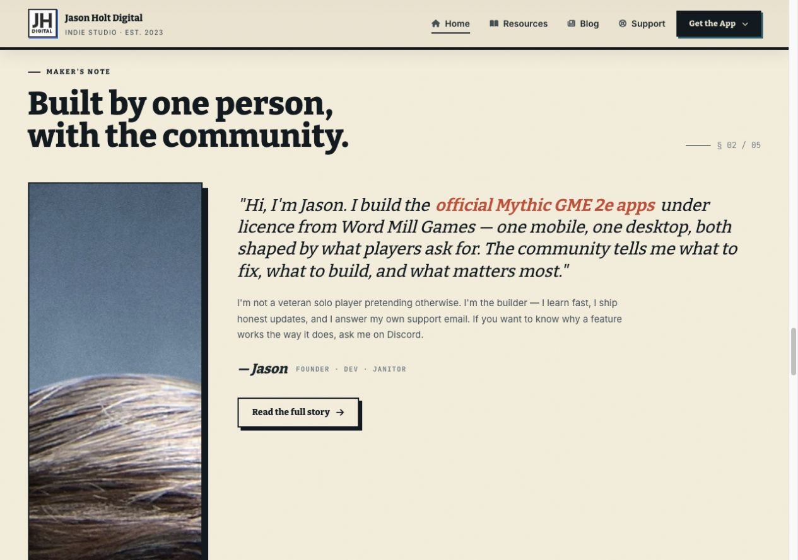
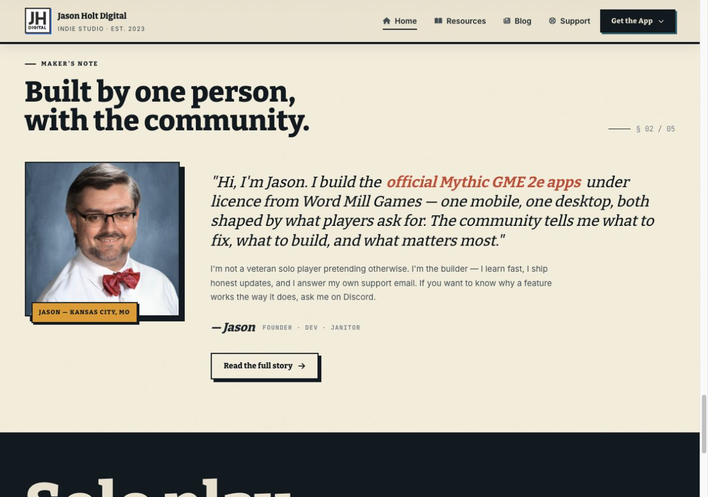
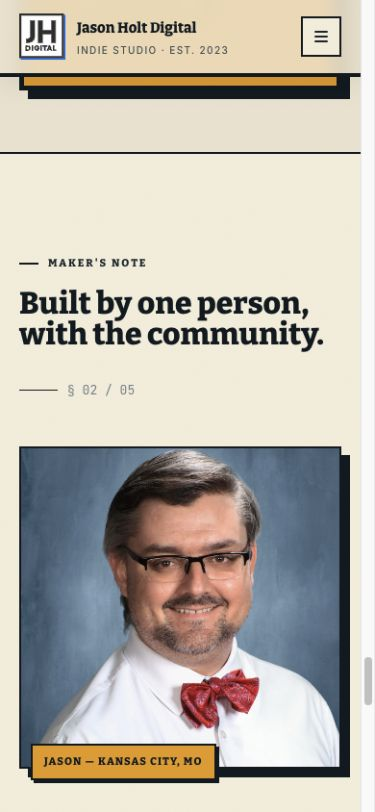

# Astro 7.4 release verification

Verified locally on 2026-10-16 with Node v22.22.3.

## Automated checks

- `npm test`: 30 tests passed across four files.
- `npm run check`: 94 files, zero errors, warnings, or hints.
- `npm run doctor -- --json`: 100/100, zero errors and warnings; previously 47 warnings.
- `npm run build`: successful static build, 177 generated routes plus the 404 page.
- `wrangler deploy --dry-run`: successful using Astro's generated `dist/client/wrangler.json`.
- Generated output comparison against the saved pre-cleanup build: 178 HTML files, unchanged page text and metadata, unchanged four search indexes, and no missing local asset references.

## Codex review correction

The second `codex review --uncommitted` completed with no actionable regressions. It independently passed all 30 tests, checked 94 files without errors or warnings, and compiled 26 changed Astro files. The production build and browser checks below were performed separately from the read-only review.

The first native Codex review found that replacing raw v2 images with Astro's `Image` component added intrinsic HTML heights. Existing width-only CSS then stretched the portrait, screenshot stacks, and artwork. The v2 image reset now includes `height: auto`; specific image containers retain their existing height rules.

The portrait reproduced the failure at 280 × 3000 pixels on desktop. After the correction it matches the baseline at 280 × 280; mobile matches at 335 × 335.

Browser checks at 1280 × 900 and 390 × 844 compared the saved baseline and corrected build on v2 home, About, Resources, Blog, and Support. Portraits, phone and desktop stacks, and visible artwork match their baseline dimensions. No horizontal overflow was detected. Intrinsic dimensions also reserve space for lazy images before loading; unloaded baseline images did not reserve this space.

The observations are in [responsive-image-metrics.json](responsive-image-metrics.json).

| Before review correction | After, desktop | After, mobile |
| --- | --- | --- |
|  |  |  |

## Lighthouse

Local original homepage spot-checks using the same Lighthouse setup:

| Build and device | Performance | Best Practices | SEO |
| --- | ---: | ---: | ---: |
| Saved pre-cleanup baseline, mobile | 78 | 96 | 100 |
| Release candidate, mobile | 83 | 96 | 100 |
| Release candidate, desktop | 99 | 96 | 100 |

Mobile performance remains below the repository's 90 target. These are local lab measurements, not field performance data. The Font Awesome kit returns HTTP 403 on localhost, which affects the Best Practices result.

## Rollback

Revert the release commit and let the existing Cloudflare build integration redeploy. The production version before this release was `bef8448d-1495-4999-ada7-6b83bc02b76b` on worker `jhd-astro-web`.
